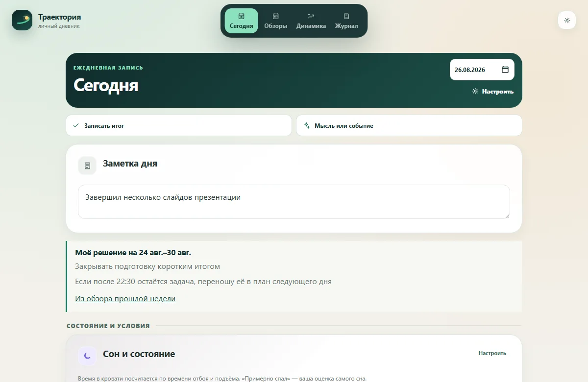
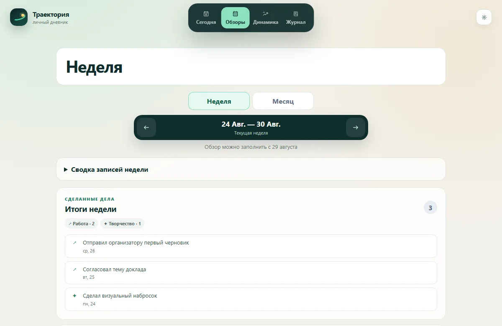
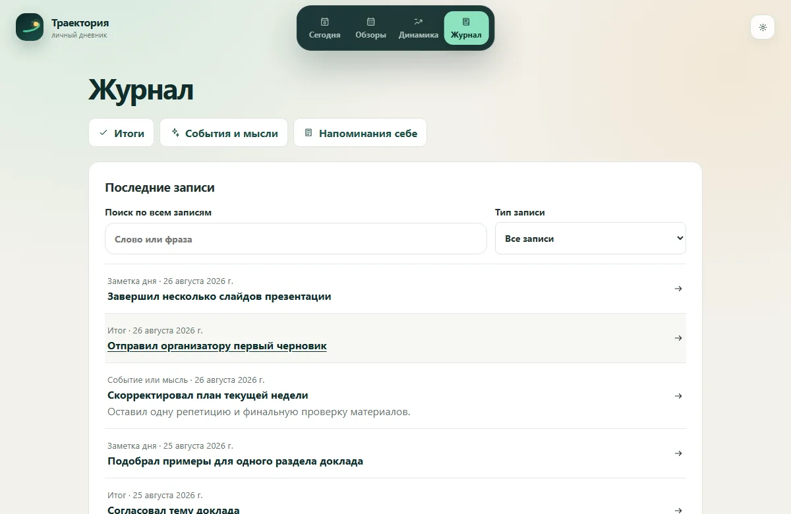

# Trajectory

A personal journal connecting daily notes with weekly and monthly reflection. The interface is in Russian. [Open the app](https://trajectory-life.ru) · [Data policy](https://trajectory-life.ru/data-policy).

## Using Trajectory

| Section | What you can do |
| --- | --- |
| **Today** | Write a daily note and optionally track sleep, energy, activities, context and nutrition. Revisit the weekly decision, see when a review is due, and follow up on goals and experiments. Saved principles stay in view on wide screens and are one tap away on mobile. |
| **Reviews** | Review a week or month, read the entries from that period and choose a next step. Navigation preserves the selected date. A monthly review links to saved weekly reviews and daily notes and lets you open your recurring questions by topic. |
| **Dynamics** | Explore charts and comparisons, trace observations and decisions back to their source reviews, and revisit completed experiments. |
| **Journal** | Search daily notes, results, events and thoughts, and personal reminders together. Open a result to go to the original entry. In **Notes to Self**, save principles, questions to revisit and lessons from past experience. |

Settings cover daily fields, experiments, optional account sync, and JSON backup and restore. Reviews and Dynamics offer separate exports for external analysis. The app can be installed as a PWA.

Local drafts can be recovered for daily notes, journal entries and reviews. Saving an edit checks whether the stored record changed while the editor was open.

There is no score for a person or a day. Missing fields stay missing; you choose what to record. The app does not automatically send journal entries to an AI service.





## Local development

Use Node.js 22.22.2 or a later 22.x release, matching [package.json](package.json) and `.nvmrc`.

```sh
npm ci
cp .env.example .env.local
npm run dev
```

The supplied environment defaults to local browser storage without mandatory authentication. Cloud sync requires a configured Supabase-compatible backend, migrations and Edge Functions. Keep privileged credentials out of all `VITE_*` values. Signup, feedback, error monitoring and product telemetry have separate configuration gates.

```sh
npm run check
npx playwright install chromium webkit
npm run test:e2e
```

Built with Vue 3, TypeScript, Pinia, Vue Router, Dexie, Supabase, ECharts and Vite. `npm run storybook` opens the component catalogue; `npm run landing:capture` refreshes screenshots using synthetic data.

## Data boundary

Product telemetry is opt-in and excludes journal text and recorded values. Local backup, cloud sync and analysis export are different operations. Unsaved editor drafts stay on the device, outside cloud sync and JSON backups.

[MIT License](LICENSE)
