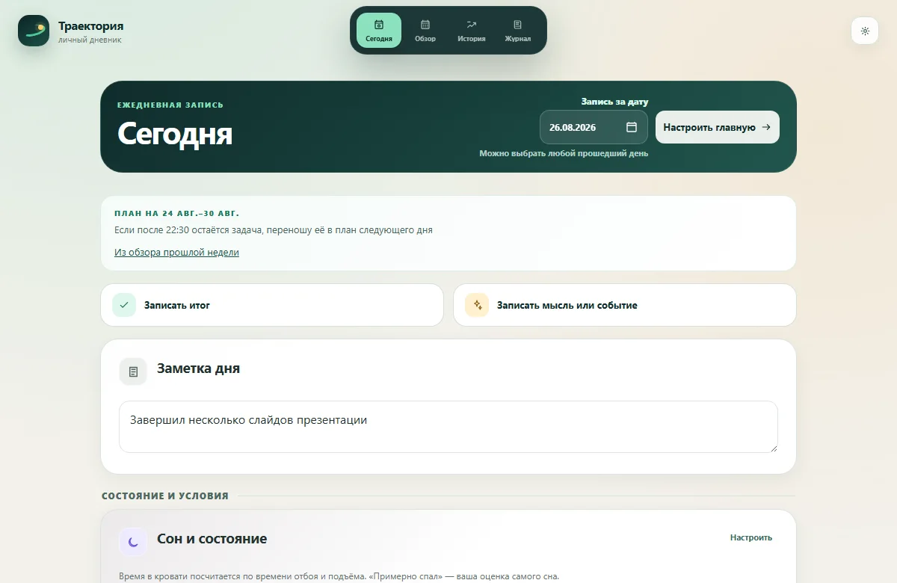
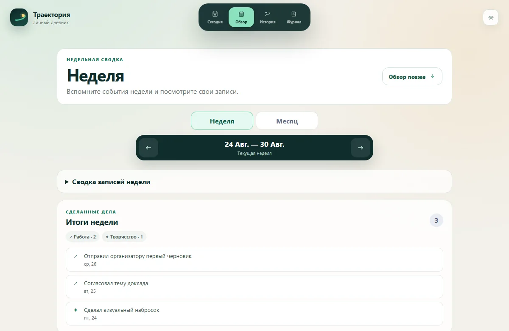

# Trajectory

A personal journal connecting daily notes with weekly and monthly reflection. The interface is in Russian. [Open the app](https://trajectory-life.ru) · [Data policy](https://trajectory-life.ru/data-policy).

## Current workflows

- Daily notes with optional sleep, energy, activities, context and nutrition fields.
- Weekly and monthly reviews, a current goal, concrete next steps and personal experiments.
- Separate archives of results and life events, search and charts over time.
- Compatible JSON backup/restore and a separately prepared export for external analysis.
- Local IndexedDB storage, optional account sync and PWA installation.

There is no score for a person or a day. Missing fields stay missing; you choose what to record. The app does not automatically send journal entries to an AI service.




## Local development

Use Node.js 22, matching [package.json](package.json) and `.nvmrc`.

```sh
npm ci
cp .env.example .env.local
npm run dev
```

The supplied environment defaults to local browser storage without mandatory authentication. Cloud sync requires a configured Supabase-compatible backend, migrations and Edge Functions. Keep privileged credentials out of all `VITE_*` values. Signup, feedback, error monitoring and product telemetry have separate configuration gates.

```sh
npm run check
npx playwright install chromium webkit
npm run test:e2e
```

Built with Vue 3, TypeScript, Pinia, Vue Router, Dexie, Supabase, ECharts and Vite. `npm run storybook` opens the component catalogue; `npm run landing:capture` refreshes screenshots using synthetic data.

## Data boundary

The account snapshot uses Auth and row-level security. Administrators retain technical access; client-side encryption is not implemented. Product telemetry is opt-in and excludes journal text and recorded values. Local backup, cloud sync and analysis export are different operations.

[MIT License](LICENSE)
